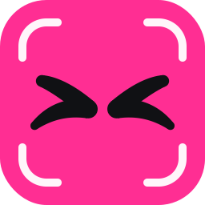
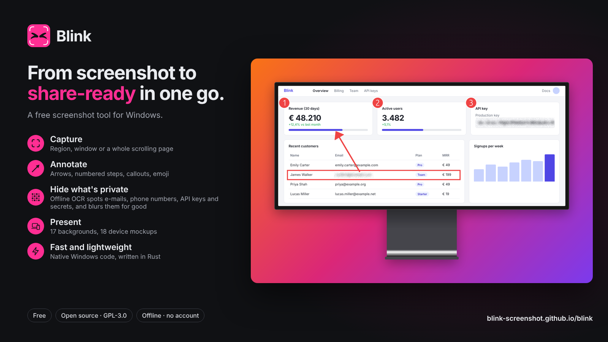
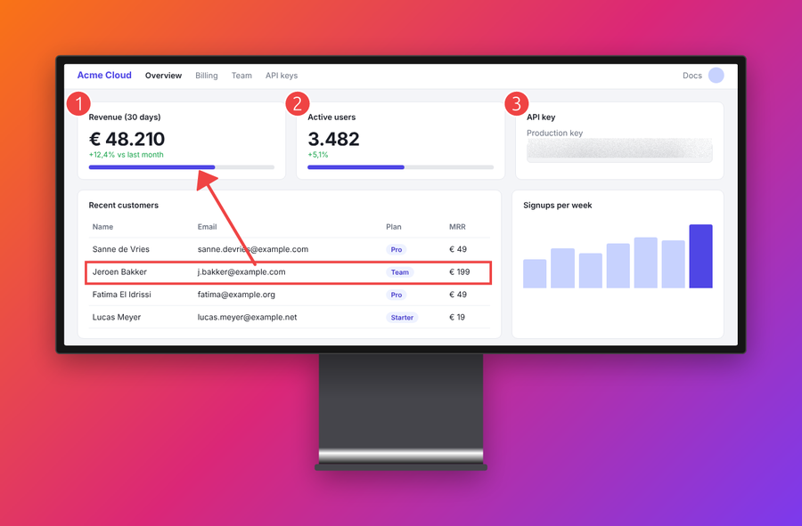
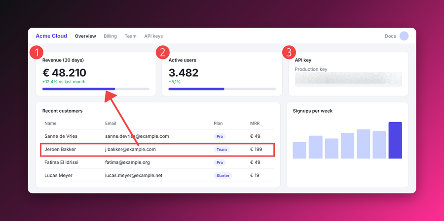
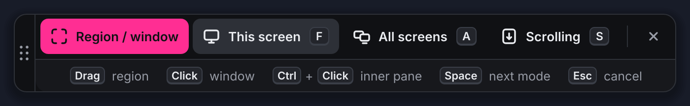

# Blink

**Screenshots that look finished the moment you take them.**

A free, open-source screenshot tool for Windows: capture a region, a window or a whole scrolling page, mark it up, black out what is private, and put it on a background or a device mockup. It also records the screen to MP4 or GIF.

[Website](https://blink-screenshot.github.io/blink/) · [Download](https://github.com/blink-screenshot/blink/releases/latest) · [Changelog](CHANGELOG.md) · [Report a bug](https://github.com/blink-screenshot/blink/issues/new/choose)

## Why Blink

Most screenshot tools stop at "capture and draw an arrow". Blink goes one step further: the screenshot you copy is ready to paste into a bug report, a how-to, a slide or a social post. No second app to add a background, no worrying whether your blur can be undone.

- **Capture exactly what you point at.** Windows snap to their real visible edge, also on GPU-rendered apps (Chrome, Edge, Electron) where other tools return a black window. 1:1 pixels on mixed-scaling multi-monitor setups.
- **Redaction that holds.** Blink's blur reduces the area to blocks, blurs it three times and adds noise, so text cannot be reconstructed. For passwords there is a black box. *Find private info* reads the screenshot and suggests what to hide: e-mail addresses, phone numbers, IBANs, card numbers, keys and passwords.
- **Copy text from anything on the screen.** Point at a line, Ctrl + click a paragraph or drag over a region, and the text is on your clipboard. Tables come along as tables: paste them into Excel, Word or Teams. Or select text in a screenshot in the editor. It uses the OCR engine built into Windows, so it works offline.
- **Present it.** 17 backgrounds and 18 device frames (iPhone, Pixel, iPad, MacBook, Surface, monitors, browser and app windows), with padding, rounded corners and shadow. Copy and Save include the frame at full resolution.
- **Small and private.** A tray app in plain Win32 with no UI framework. No account, no cloud, no telemetry. The only network request is a daily update check on GitHub, which you can turn off.

## Features

| | |
|---|---|
| **Capture** | Region, window (hover and click), inner pane (Ctrl + click, for example a browser's page), screen under the mouse, all screens, active window, and **scrolling capture** of a whole page. One overlay over all monitors, with a magnifier and a mode bar. Optionally with the mouse pointer, as a separate object in the editor. |
| **Annotate** | Arrows (five head styles), lines, rectangles, ellipses, shapes (star, hexagon, flowchart shapes), freehand, highlighter, text (bold, italic, underline, strikethrough, background), speech bubbles, **numbered steps**, 54 **emoji stamps**, crop. Colour picker with eyedropper. Every tool has a one-key shortcut and remembers its last settings. |
| **Redact** | Blur, pixelate or black box. Click a word, key or e-mail address to hide it, or drag over anything. **Find private info** suggests what to hide (e-mail addresses, phone numbers, IBANs, card numbers, IP addresses, keys and tokens, passwords, BSN), you confirm. |
| **Record** | A video of a region, window or screen, as **MP4 or GIF**: a 3-2-1 countdown, a small bar with time, pause, stop and discard. The mouse pointer, a highlight around it, rings where you click and (if you want) the shortcuts you press are added when you save, so you can switch them off afterwards. Trim the start and end in the clip window, with a size estimate before you save. Uses the video encoder in Windows, so the download hardly grew. |
| **Text (OCR)** | **Copy text from the screen**: a text mode in the capture overlay that copies the line you point at, a paragraph (Ctrl + click) or all text in a region. Text that forms a **table** is copied as a table (HTML and tab-separated), so Excel, Word, Outlook and Teams paste real rows and columns; the borders of a table decide its rows and columns, and a click on the border copies the whole table. In the editor: select text like in a document, copy it, or hide it. Offline, with the OCR engine of Windows. **QR codes**: point at one in the overlay to copy what it says, or Ctrl + click to open its link. |
| **Present** | Backgrounds (gradients, mesh, waves, solid, transparent, your own), canvas ratios and exact sizes for social media and slides, device mockups that pick the device fitting your screenshot. |
| **Output** | Copy, Save to a fixed folder, Save as (PNG, JPEG, WebP). File names with variables (`{date}`, `{time}`, `{app}`, `{n}`, ...) and folders per month or per app. After a capture: open the editor, copy, save, **pin to the screen**, or ask with a small menu at the mouse. Notification with Edit, Save, Save as and Pin. A **pinned screenshot** appears at once and stays above other windows in a small frameless window with Copy, Save as, Edit, opacity and zoom. **History** in the tray menu: your latest screenshots, to copy or edit again. |
| **Everything else** | Configurable hotkeys with an Override for keys other apps have taken, start with Windows, automatic updates with checksum verification, English, Dutch, German, French, Spanish and Portuguese, dark and light theme. |

  
  

  

## Install

1. Download **[Blink-Setup.exe](https://github.com/blink-screenshot/blink/releases/latest/download/Blink-Setup.exe)** (or the [portable exe](https://github.com/blink-screenshot/blink/releases/latest/download/Blink-portable.exe)).
2. Run it. Blink installs per user in `%LOCALAPPDATA%\Programs\Blink`, without admin rights, and starts with Windows (you can switch that off).
3. Press **Print Screen**.

The installer is not code-signed yet, so Windows SmartScreen warns the first time: choose *More info*, then *Run anyway*. Every release is built by GitHub Actions from this repository, and the release page lists the SHA-256 checksum of each file. Signing is on its way: see the [code signing policy](https://blink-screenshot.github.io/blink/code-signing.html).

**Windows 11:** turn off *Settings > Accessibility > Keyboard > Use the Print Screen key to open screen capture*, or Windows keeps Print Screen for the Snipping Tool. Blink's settings show for each hotkey whether it works, with a button to that Windows setting and an **Override** button.

Blink checks for updates once a day. Installing an update is one click; the download is verified against the checksum GitHub publishes.

## Default hotkeys

| Action | Hotkey |
|---|---|
| Region / window | `Print Screen` |
| Screen under the mouse | `Shift + Print Screen` |
| Active window | `Alt + Print Screen` |
| Scrolling page | `Ctrl + Shift + Print Screen` |
| Copy text from the screen | `Ctrl + Alt + Print Screen` |
| Record the screen (again to stop) | `Ctrl + Alt + Shift + Print Screen` |
| Capture menu | `Ctrl + Print Screen` |

**In the capture overlay:** drag = region · click = window · hold Ctrl = inner pane · `F` this screen · `A` all screens · `S` scrolling · `T` copy text (click = line, Ctrl + click = paragraph, drag = region) · `R` record (drag = region, click = window, `F` = screen) · Space = next mode · arrow keys = move the mouse 1 px · `Esc` or right-click = cancel.

**In the editor:** `V` select, `X` select text (OCR), `R` rectangle, `E` ellipse, `S` shapes, `L` line, `A` arrow, `P` freehand, `H` highlighter, `T` text, `O` speech bubble, `N` step, `M` emoji, `B` blur, `C` crop · hold `Ctrl` to select with any tool · `Shift` = straight/square · `Ctrl+Z / Ctrl+Y` · `Ctrl+C` copy, `Ctrl+S` save, `Ctrl+Shift+S` save as, `Ctrl+P` pin to the screen · `F1` or `?` lists every shortcut.

## Limitations

- **Windows 10 and 11, 64-bit only** for now. The editor is portable; capture, hotkeys and the tray are Windows code. See [docs/PLATFORMS.md](docs/PLATFORMS.md) for what macOS and Linux need.
- **Screen recording** has no sound yet, records one monitor at a time, and a window is recorded as the area it had when you started (it does not follow the window if you move it). Windows N editions need the Media Feature Pack for it.
- **Text recognition reads the languages installed in Windows** (Settings > Time & language > Language & region). It reads printed screen text well and handwriting poorly, and it can misread characters: *Find private info* is a help, not a guarantee.
- **Scrolling capture** scrolls with simulated mouse wheel steps. It works in browsers, editors, chat apps and File Explorer; it can stop early on content that changes while scrolling (video, animations, lazy loading).

## Support Blink

Blink is free and stays free. If it saves you time:

- ⭐ **Star the repository**, it helps others find it.
- ☕ **Buy me a coffee** on [Ko-fi](https://ko-fi.com/blinkscreenshot).
- 🐛 **Report bugs and ideas** in [Issues](https://github.com/blink-screenshot/blink/issues/new/choose).

## Contributing

Pull requests are welcome. [CONTRIBUTING.md](CONTRIBUTING.md) explains how to build and test Blink (the editor and its tests also run on Linux), and [docs/DEVELOPMENT.md](docs/DEVELOPMENT.md) describes the architecture, the release process and the design system.

## License

Blink is free software under the [GNU General Public License v3.0 or later](LICENSE). Components Blink includes, and their licenses, are listed in [THIRD-PARTY-NOTICES.md](THIRD-PARTY-NOTICES.md). The emoji stamps are [Twemoji](https://github.com/jdecked/twemoji) (CC-BY 4.0); the device mockups follow the proportions of [devices.css](https://github.com/picturepan2/devices.css) (MIT).
